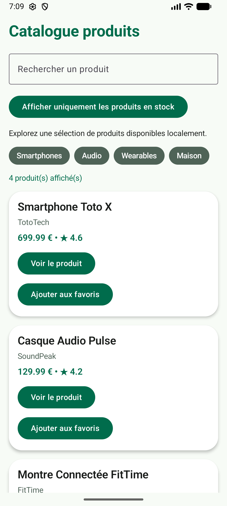
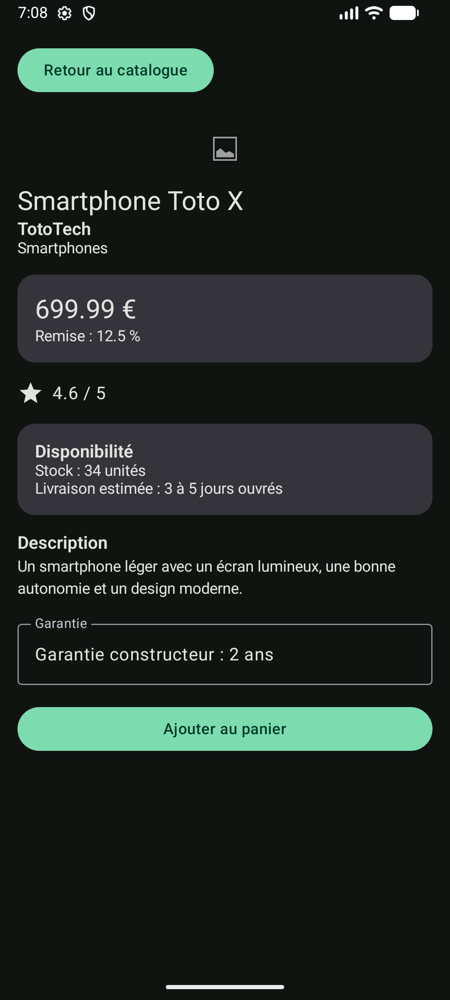
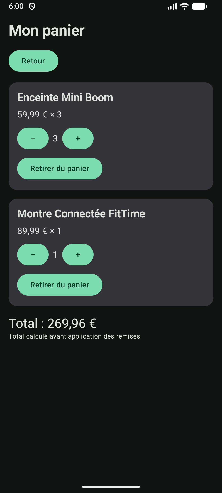

# ProductExplorer — TP4 à TP11 et fonctionnalités supplémentaires (Jetpack Compose)

Application Android de catalogue de produits développée en **Kotlin** avec **Jetpack Compose** et **Material Design 3** dans le cadre des travaux pratiques de développement Android.

L'application présente **quatre produits locaux**. Elle permet de rechercher des produits, de filtrer ceux en stock, de gérer des favoris, de consulter une fiche détaillée et d'utiliser un panier. Depuis le TP11, l'état principal de l'interface est géré par un **ViewModel** qui expose un **StateFlow**.

## Fonctionnalités par TP

### TP4 — Fiche détaillée d'un produit

- Affichage du nom, de la marque, de la catégorie, du prix, de la remise et de la note.
- Illustration de remplacement, description, disponibilité et informations de livraison.
- Garantie affichée dans un `OutlinedTextField` en lecture seule.
- Bouton « Ajouter au panier » initialement prévu avec un callback, devenu fonctionnel après le TP11.
- Previews d'un produit disponible et d'un produit en rupture de stock.

### TP5 — Écran d'accueil

- En-tête `HomeHeader` et aperçu de barre de recherche `SearchPreviewBar`.
- Produit mis en avant avec récapitulatif du prix, de la note et du stock.
- Catégories et encart « Offre du jour ».
- Preview de l'écran d'accueil.

### TP6 — Catalogue local

- Quatre produits d'exemple dans `sampleProducts()`, chacun avec un identifiant unique.
- Défilement vertical du catalogue avec `LazyColumn` et `items`.
- Catégories sur une ligne horizontale avec `LazyRow`.
- Cartes réutilisables `ProductListItem`.
- Preview du catalogue.

### TP7 — Material Design 3

- Palettes personnalisées **claire et sombre** dans `ui/theme/Theme.kt`.
- Typographie dans `ui/theme/Type.kt`.
- Formes arrondies, couleurs du thème et élévation des cartes.
- Previews du catalogue en thèmes clair et sombre.
- Thème de l'application adapté au réglage de l'appareil.

### TP8 — Interactions locales

- Recherche par **nom, marque ou catégorie**, sans distinction entre majuscules et minuscules.
- Filtre « En stock uniquement » (stock strictement supérieur à zéro).
- Recherche et filtre de stock combinables.
- Compteur du nombre de produits affichés.
- Ajout et retrait des favoris à partir de l'identifiant du produit.
- Première gestion locale de ces états avec `rememberSaveable`, réorganisée dans les TP suivants.

### TP9 — State Hoisting

- Séparation entre `ProductCatalogContainer` (**Stateful**) et `ProductCatalogScreen` (**Stateless**).
- Remontée des événements grâce aux callbacks.
- `ProductListItem` reste un composant Stateless.
- Principe appliqué : les données descendent, les événements remontent.
- Conservation des fonctionnalités du TP8.

### TP10 — ViewModel

- Introduction de `ProductCatalogViewModel` pour déplacer les états et les actions hors des composables.
- `ProductCatalogContainer` relie le ViewModel à `ProductCatalogScreen`.
- Gestion initiale des états avec `mutableStateOf`, remplacée au TP11 par `StateFlow`.
- Conservation de la recherche, du filtre et des favoris lors de la rotation de l'écran.

### TP11 — StateFlow et état d'interface

- Création de `ProductCatalogUiState`, une `data class` qui regroupe les valeurs nécessaires à l'affichage.
- Utilisation de `MutableStateFlow` **privé** dans `ProductCatalogViewModel`.
- Exposition d'un `StateFlow` en lecture seule avec `asStateFlow()`.
- Modification de l'état par `_uiState.update { currentState -> currentState.copy(...) }`.
- Filtrage recalculé dans le ViewModel lorsque la recherche ou le filtre stock change.
- Observation de l'état dans `ProductCatalogContainer` grâce à `collectAsState()`.
- `ProductCatalogScreen` et `ProductListItem` continuent d'afficher les données et de transmettre les interactions.

## Fonctionnalités supplémentaires après le TP11

### Navigation vers la fiche produit

- Ouverture de la fiche détaillée avec le bouton **« Voir le produit »** du catalogue.
- Affichage du produit sélectionné : nom, marque, catégorie, prix, remise, note, stock, livraison, description et garantie.
- Défilement vertical de la fiche avec `verticalScroll`.
- Retour au catalogue avec un bouton dédié ou le bouton Retour Android.
- Conservation de la recherche, du filtre stock et des favoris lors du retour.

**Fonctionnement technique :**

- `selectedProduct` dans `ProductCatalogUiState` représente le produit ouvert, ou `null` pour le catalogue.
- `onProductSelected()` sélectionne un produit ; `onBackToCatalog()` ferme sa fiche.
- `ProductCatalogContainer` affiche `ProductCatalogScreen` ou `ProductDetailScreen` selon l'état.
- `BackHandler` gère le bouton Retour Android.

### Gestion du panier

- Ajout d'un produit au panier depuis sa fiche détaillée.
- Ouverture du panier depuis le catalogue ou la fiche produit.
- Affichage des articles et de leurs quantités dans `CartScreen`.
- Augmentation et diminution des quantités avec les boutons **+** et **−**.
- Suppression d'un article avec « Retirer du panier ».
- Actualisation automatique du nombre total d'unités dans le bouton du panier.
- Calcul automatique du total des produits à partir de leur prix et de leur quantité.
- Blocage de l'ajout pour les produits en rupture de stock.
- Limitation de la quantité au stock disponible.
- Conservation du panier pendant la navigation entre les écrans.

**Fonctionnement technique :**

- `CartItem` associe un `ProductUi` à une quantité (`quantity`).
- `cartItems: List<CartItem>` contient les articles du panier dans `ProductCatalogUiState`.
- `isCartOpen` indique que l'écran du panier est affiché.
- `onAddToCart()` ajoute un article ou augmente sa quantité.
- `onIncreaseQuantity()` et `onDecreaseQuantity()` ajustent les quantités. Diminuer une quantité de 1 retire l'article.
- `onRemoveFromCart()` retire directement un produit.
- `onOpenCart()` et `onCloseCart()` contrôlent l'affichage du panier.
- `CartScreen` reçoit les données et callbacks du conteneur, sans gérer lui-même l'état du panier.
- Le ViewModel publie les nouveaux états avec `_uiState.update` et `copy()`. Compose les observe avec `collectAsState()`.

**Calcul du total :** somme des `prix × quantité`, **avant application des remises**. Le panier ne réalise aucun paiement.

### Captures d'écran

| Catalogue produits | Fiche détaillée |
| --- | --- |
|  |  |

**Panier :**



## Architecture actuelle

```text
MainActivity
    └── ProductCatalogContainer (Stateful)
            │
            ├── ProductCatalogViewModel
            │       └── StateFlow<ProductCatalogUiState>
            │               ├── products
            │               ├── categories
            │               ├── searchQuery
            │               ├── showOnlyInStock
            │               ├── favoriteProductIds
            │               ├── selectedProduct
            │               ├── cartItems : List<CartItem>
            │               └── isCartOpen
            │
            ├── ProductCatalogScreen (Stateless)
            │       ├── CategoryRow
            │       │       └── CategoryChip
            │       └── ProductListItem (Stateless)
            │
            ├── ProductDetailScreen
            │       ├── ProductImage
            │       ├── ProductHeader
            │       ├── ProductPriceCard
            │       ├── ProductRating
            │       ├── ProductAvailabilityCard
            │       ├── ProductDescription
            │       ├── ProductWarrantyField
            │       └── AddToCartButton
            │
            └── CartScreen (Stateless)
                    ├── Articles du panier
                    ├── Boutons de quantité
                    ├── Retrait des articles
                    └── Total calculé
```

### Rôle des composants

- **`MainActivity`** : lance l'application et affiche le conteneur principal.
- **`ProductCatalogViewModel`** : centralise les données, la recherche, le filtre stock, les favoris, le produit sélectionné et les actions sur le panier.
- **`ProductCatalogUiState`** : regroupe les informations de l'interface dans un état observable.
- **`ProductCatalogContainer`** : observe `uiState` et affiche le catalogue, la fiche produit ou le panier.
- **`ProductCatalogScreen`** : affiche le catalogue et transmet les actions utilisateur grâce aux callbacks.
- **`ProductListItem`** : affiche chaque produit avec « Voir le produit » et « Ajouter aux favoris ».
- **`ProductDetailScreen`** : présente la fiche détaillée et le bouton d'ajout au panier.
- **`CartScreen`** : affiche les articles, les contrôles de quantité et le total.

### Gestion de la navigation

- `selectedProduct` détermine la fiche ouverte lorsque le panier est fermé.
- `isCartOpen` donne la priorité à l'affichage du panier.
- Le bouton Retour Android ferme d'abord le panier lorsqu'il est ouvert, puis permet de revenir au catalogue depuis une fiche produit.
- L'application n'utilise pas Navigation Compose pour ces écrans.

## Données d'exemple

| Produit | Catégorie | Stock initial |
| --- | --- | ---: |
| Smartphone Toto X | Smartphones | 34 |
| Casque Audio Pulse | Audio | 0 |
| Montre Connectée FitTime | Wearables | 18 |
| Enceinte Mini Boom | Audio | 52 |

Ces données sont définies localement dans le code. **Aucune API, base de données ou authentification** n'est utilisée.

## Tests fonctionnels

### Catalogue et favoris (TP8 à TP11)

1. Démarrer l'application avec le champ vide : **4 produits** visibles.
2. Rechercher `audio` : **2 produits** affichés.
3. Effacer la recherche : retour à **4 produits**.
4. Activer « En stock uniquement » avec la recherche vide : **3 produits**.
5. Rechercher `audio` en conservant ce filtre : **1 produit**, « Enceinte Mini Boom ».
6. Ajouter un produit aux favoris, puis cliquer à nouveau pour le retirer.
7. Combiner recherche, filtre et favoris : le compteur et les boutons se mettent à jour.
8. Faire pivoter l'émulateur avec les filtres et un favori actifs : l'état est conservé par le ViewModel.
9. Vérifier les previews du catalogue en modes clair et sombre.

### Navigation vers les fiches produits

1. Ouvrir une fiche avec « Voir le produit ».
2. Vérifier que les informations correspondent au produit sélectionné.
3. Revenir au catalogue avec le bouton dédié puis avec le bouton Retour Android.
4. Vérifier la conservation de la recherche, du filtre stock et des favoris.

### Panier

1. Ajouter un produit depuis sa fiche détaillée et ouvrir le panier.
2. Appuyer sur **+** : le total et la quantité augmentent (par exemple, 2 smartphones à 699,99 € = **1 399,98 €**).
3. Appuyer sur **−** : la quantité et le total diminuent.
4. Ajouter plusieurs produits différents et vérifier leur affichage.
5. Retirer un article et vérifier le nouveau total.
6. Retirer le dernier article et vérifier le message de panier vide.
7. Vérifier qu'un article avec un stock de 0 ne peut pas être ajouté.
8. Vérifier que la quantité maximale est limitée au stock disponible.
9. Revenir au catalogue ou à une fiche produit et retrouver le panier.
10. Vérifier que le projet compile et que l'application fonctionne sur l'émulateur.

## Limites actuelles

- Le panier, les favoris et les autres états du ViewModel restent en mémoire, sans sauvegarde permanente après la fin du processus Android.
- Le total du panier est calculé **avant remises**.
- Aucune gestion des commandes, du paiement ou de la livraison réelle n'est implémentée.
- Les fiches utilisent une image de remplacement plutôt que des photographies propres à chaque produit.

## Notions et technologies utilisées

- **Interface :** Jetpack Compose, `@Composable`, `@Preview`, `Modifier`, `LazyColumn`, `LazyRow`, `Card`, `Button`, `OutlinedTextField`, `verticalScroll`.
- **Apparence :** Material Design 3, couleurs, typographie, formes, thèmes clair et sombre.
- **États des premiers TP :** `remember`, `rememberSaveable`, `mutableStateOf`, State Hoisting.
- **Architecture actuelle :** `ViewModel`, `ProductCatalogUiState`, `CartItem`, `MutableStateFlow`, `StateFlow`, `asStateFlow()`, `update`, `copy`, `collectAsState()`, `BackHandler`.

## Structure principale

- `app/src/main/java/com/example/productexplorer/MainActivity.kt` : activité, données locales, ViewModel, écrans et composants Compose.
- `app/src/main/java/com/example/productexplorer/ui/theme/Theme.kt` : palettes de couleurs et formes.
- `app/src/main/java/com/example/productexplorer/ui/theme/Type.kt` : typographie.
- `app/src/main/res/` : ressources Android.
- `gradle/libs.versions.toml` et `app/build.gradle.kts` : configuration des dépendances.
- `screenshots/` : captures de l'application pour le README.

## Lancer le projet

1. Cloner le dépôt :
   ```bash
   git clone https://github.com/AlexTng44000/ProductExplorer.git
   ```
2. Ouvrir le dossier `ProductExplorer` dans Android Studio.
3. Synchroniser Gradle.
4. Sélectionner un émulateur Android.
5. Exécuter la configuration **app** avec **Run**.

## Dépôt GitHub

https://github.com/AlexTng44000/ProductExplorer

Les fonctionnalités ont été ajoutées progressivement, avec des commits séparés pour les différentes étapes des TP et leurs extensions.
